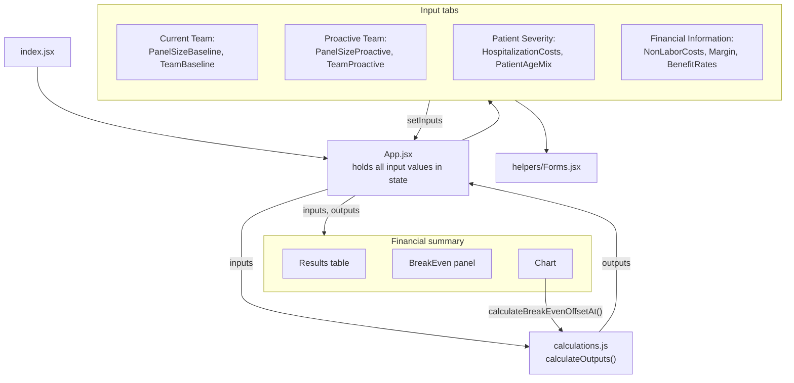

# Technical architecture

## Overview

The calculator is a single-page web application that runs entirely in the user's browser.

- There is **no server, database, or external service**. Nothing is sent over the network after the page loads.
- All calculations are done by one small, dependency-free module (`src/calculations.js`) so they can be read,
  tested, and cited independently of the user interface.
- The user interface is a set of React components that collect inputs, pass them to the calculation module,
  and display the results.
- The production build is a folder of static files that any web server can host.

## Technology

| Purpose | Technology | Version |
| --- | --- | --- |
| Language | JavaScript (ES modules), JSX | |
| User interface | React | 19 |
| Charting | Recharts | 3 |
| Build tool and dev server | Vite | 8 |
| Test runner | Vitest | 5 |
| UI testing | Testing Library (React, DOM, user-event, jest-dom) and jsdom | |
| Runtime for tooling | Node.js | 22.22.2+ (24 LTS recommended) |

Exact dependency versions are recorded in `package.json` and locked in `package-lock.json`.

## Source layout

```
index.html                         page shell loaded by the browser
src/
  index.jsx                        mounts <App /> into the page
  App.jsx                          state, layout, tabs
  App.css, index.css               styles
  calculations.js                  ALL calculation logic and default values
  helpers/Forms.jsx                shared form helpers (input rows, sum, text-to-number)
  components/
    inputs/                        one form per group of inputs, plus Tooltip
    outputs/                       Results table, BreakEven panel, Chart
    hospital_spend/                debugging worksheet (not shown in the app)
test/                              automated tests (see TESTING.md)
```

## Component structure



## Data flow

1. `App.jsx` keeps one object of input values in React state. It starts as `DEFAULT_INPUTS`.
2. Each input form shows a group of those values in number boxes. When the user types, the form's change
   handler converts the text to a number (blank or invalid text becomes 0) and updates that one value.
3. On every change React re-renders `App`, which calls `calculateOutputs(inputs)`. This is a pure function: the
   same inputs always give the same outputs, and it has no side effects.
4. The outputs are passed to `Results`, `BreakEven`, and `Chart` for display. Money is shown with 2 decimals
   and patient counts as whole numbers.
5. The chart additionally calls `calculateBreakEvenOffsetAt(x, inputs, outputs)` to draw the break-even line.

Because the calculation is a pure function of the inputs, nothing is stored, cached, or persisted between visits.

## Inputs

The model uses two teams: **baseline** (the current team) and **proactive** (the alternative team).

| Input | Default | Meaning |
| --- | ---: | --- |
| Panel size, baseline / proactive | 2,700 / 2,700 | Patients per primary care physician |
| FTE per role, baseline / proactive | see below | Full-time equivalents of each staff role |
| Salary per role | see below | Annual salary; shared by both teams; set in code (no input box) |
| Benefit rate | 50 | Percent added to salaries |
| Net margin | 3 | Percent of revenue retained; used to gross up the capitation rate |
| Non-labor cost per patient | 21 | Dollars per patient per year |
| Hospital cost offset | 25 | Percent reduction in hospital and ED spending achieved by the proactive team |
| Hospitalization cost | 0 | Baseline hospital and ED spend PMPM, if known. 0 means "estimate from the age mix" |
| Patient age mix | 25 / 31 / 27 / 17 | Percent of patients aged 0-18 / 19-44 / 45-64 / 65+ |

Staff roles, with default FTE and salary:

| Role | Baseline FTE | Proactive FTE | Salary |
| --- | ---: | ---: | ---: |
| Primary care physician | 1 | 1 | $267,373.01 |
| APC, NP, or PA | 0.5 | 1 | $137,418.67 |
| Medical assistant | 2 | 4 | $46,555.78 |
| Registered nurse | 0.5 | 2 | $102,470.60 |
| Athletic trainer | 0 | 1 | $66,585.59 |
| Pharmacist | 0 | 1 | $142,842.54 |
| Healthcare social worker | 0.25 | 2 | $74,986.87 |
| Mental health professional | 0.25 | 1 | $67,772.39 |
| Clerical staff | 1 | 2 | $47,451.08 |
| Community health worker | 0 | 3 | $58,267.60 |

### Reference data

Hospital and ED spending can be estimated from patient age using fixed reference values (`FIXED_VALUES` in
`src/calculations.js`). Source and year: *to be completed by the authors.*

| Age band | Annual hospital + ED cost per person |
| --- | ---: |
| 0-18 | $782.35 |
| 19-44 | $1,510.87 |
| 45-64 | $2,663.78 |
| 65+ | $4,349.76 |

An adjustment factor of 0.2716506 (`mepsFactor`) is applied on top of these values.

## Formulas

Notation: subscript *T* is either baseline (*B*) or proactive (*P*). *n* is FTE, *s* is salary, *b* is the benefit
rate in percent, *N* is panel size, *c* is non-labor cost per patient, *m* is margin in percent, *h* is the
entered hospitalization cost, *a₁..a₄* is the age mix in percent, *H₁..H₄* is the age-band reference cost,
*k* is the adjustment factor, and *o* is the hospital cost offset in percent.

| Result | Formula |
| --- | --- |
| Labor cost | `Labor_T = (sum over the 10 roles of n_T x s) x (1 + b / 100)` |
| Non-labor cost | `Variable_T = c x N_T` |
| Total cost | `Total_T = Labor_T + Variable_T` |
| Capitation rate (PMPM) | `Cap_T = Total_T / ((1 - m / 100) x N_T) / 12` |
| Capitation rate difference | `Cap_P - Cap_B` |
| Hospital + ED spending, baseline (PMPM) | `Hosp_B = h` if `h` is not 0, otherwise `(a₁H₁ + a₂H₂ + a₃H₃ + a₄H₄) / 1200 x (1 + k)` |
| Hospital + ED spending, proactive | `Hosp_P = Hosp_B x (1 - o / 100)` |
| Hospital + ED spending difference | `Hosp_P - Hosp_B` |
| Combined spending | `Combined_T = Cap_T + Hosp_T` |
| Combined spending difference | `Combined_P - Combined_B` |
| Panel size difference | `N_P - N_B` |
| Break-even offset (%) | `(Cap_P - Cap_B) / Hosp_B x 100` |
| Break-even panel size | `N_B x Labor_P / Labor_B` |
| Chart: break-even offset at panel size multiple *x* | `((Labor_P + c x N_B x x) / ((1 - m / 100) x N_B x x) / 12 - Cap_B) / Hosp_B x 100`, rounded to 2 decimals |

Notes:

- In the age-based estimate, the divisor 1200 is 100 x 12: it converts the age mix from percent to a fraction and
  the annual cost to a monthly cost.
- **Break-even offset** is the percentage reduction in baseline hospital and ED spending that the proactive team
  must achieve for the two teams' combined spending to be equal.
- **Break-even panel size** is the panel size at which the proactive team's labor cost per patient equals the
  baseline team's, so the capitation rates are equal.
- The chart plots the break-even offset against panel size, for panel sizes from 0.25 to 4 times the baseline panel.

## Build and hosting

`npm run build` runs Vite, which bundles the code and writes a static site to `dist/` (an HTML file, one
JavaScript bundle, and one CSS file, plus images from `public/`). No server-side code is required. The site can
be hosted from any static file host.

## Testing architecture

Tests are run by Vitest with a simulated browser (jsdom). They are organized in layers:

1. **Calculation tests** call `calculateOutputs()` directly with hand-built inputs and compare each result
   with an independently worked answer.
2. **Component tests** render the input forms and result displays and check what a user would see.
3. **Page tests** render the whole app, type into it, and check the displayed results.

A custom reporter (`test/reporters/plainEnglishReporter.js`) turns the results into the plain-English summary
and the `test-report/` files. See [TESTING.md](TESTING.md).

## Design decisions and limitations

- **Client-side only.** This keeps the calculator private (no data is transmitted) and easy to host and reproduce.
- **Calculations are separate from the interface.** `src/calculations.js` has no React or browser dependencies, so
  it can be reused or reviewed on its own.
- **No input validation.** Inputs are not range-checked, so unusual values (such as a 100% margin or an empty
  panel) produce `Infinity` or `NaN`, which the page displays as text. The tests document this behavior.
- **Salaries are not editable in the interface.** They are defined in `DEFAULT_INPUTS` and apply to both teams.
- **Unused values.** `benefitRatesProactive` in `DEFAULT_INPUTS` and `hospitalCostAll` in `FIXED_VALUES` are
  defined but not used by any calculation; one benefit rate applies to both teams.
